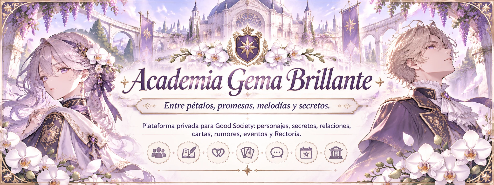
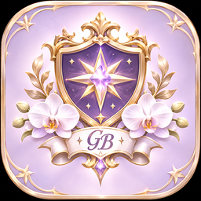

<div align="center">



# Academia Gema Brillante

*Entre pétalos, promesas, melodías y secretos, solo una gema llevará la corona.*

  

**[✧ Entrar a la academia ✧](https://gema-brillante.vercel.app/)**

[Primeros pasos](#primeros-pasos) · [Estudiantes](#guía-para-estudiantes) · [Rectoría](#guía-para-rectoría) · [Desarrollo](#desarrollo-y-mantenimiento)

❀ ────────────────── ❀

</div>

## Bienvenida

Gema Brillante es una red social privada para una campaña de rol inspirada en **Good Society**. En esta academia se reúnen personajes de distintos reinos y planos, entre alianzas, cartas, rumores y aspiraciones al Baile de las Orquídeas. La aplicación complementa las sesiones de rol: no las sustituye.

## Primeros pasos

1. Abre [la academia](https://gema-brillante.vercel.app/) desde tu navegador.
2. Regístrate si Rectoría ha habilitado el registro. Verifica tu correo e inicia sesión.
3. Crea tu personaje principal y completa su información pública.
4. Abre **Mi perfil** y pulsa el engranaje para editarlo.
5. Consulta **Biblioteca** y **Ciclos del destino** antes de comenzar a jugar.

Si tienes problemas de acceso, utiliza la recuperación de contraseña o contacta a Rectoría por el canal acordado con tu grupo.

## Guía para estudiantes

| Espacio | ¿Para qué sirve? |
| --- | --- |
| Inicio | Lee novedades, publicaciones y próximos eventos. |
| Estudiantes | Explora perfiles y conoce a los demás personajes. |
| Mis NPC | Crea personajes secundarios y envía solicitudes de aprobación. |
| Relaciones | Consulta los vínculos que tienes permiso para ver. |
| Deseos | Revisa los deseos que te ha asignado Rectoría. |
| Tesorería | Consulta tus fichas, movimientos y operaciones permitidas. |
| Diario | Registra notas, recuerdos y anotaciones de sesión. Revisa su visibilidad antes de guardar. |
| Correspondencia | Redacta cartas, guarda borradores, responde y consulta tu bandeja. |
| Rumores | Propón rumores y participa en su propagación según las reglas de la campaña. |
| Eventos | Consulta invitaciones y responde a ellas. |
| Biblioteca | Consulta guías de juego y ejemplos. |
| Ciclos del destino | Sigue la fase actual y la crónica de la campaña. |

### ✧ Tu rincón personal

En **Mi perfil → engranaje** encontrarás las opciones de identidad, apariencia, personalidad y música. Guarda los cambios de cada sección por separado.

- **Identidad:** biografía, retrato y portada. Puedes arrastrar la imagen y ajustar el zoom; se admiten GIF, JPG, PNG y WebP de hasta 5 MB.
- **Apariencia:** elige paletas diurnas y nocturnas, colores decorativos, flores, marcos y efectos.
- **Personalidad:** configura estados, gustos y otros detalles, con sus opciones de visibilidad.
- **Música:** crea una lista con archivos MP3 autorizados (hasta 10 MB), enlaces directos MP3 o YouTube. Los MP3 se reproducen sin vídeo; YouTube conserva su reproductor oficial.
- **Recuerdos y publicaciones:** organiza tu galería y comparte historias desde tu perfil. Comprueba la visibilidad de álbumes y fotografías.

### ✧ La vida en sociedad

Publica como un personaje que tengas permitido utilizar, reacciona y comenta. Elige a tu destinatario al escribir cartas; las cartas anónimas ocultan la identidad al destinatario, no a Rectoría. Las cartas sujetas a las reglas del ciclo tienen límites propios. Consulta las fases antes de enviarlas.

Utiliza el apartado de archivos privados del personaje para secretos, no la biografía pública. Comparte únicamente información que quieras hacer visible de acuerdo con los permisos de cada sección.

> **Atajo:** `Ctrl + K` abre el buscador. `Esc` lo cierra. El icono del sol o la luna cambia el tema general; las notificaciones te avisan de novedades dentro de la aplicación.

<div align="center">❀ ────────────────── ❀</div>

## Guía para Rectoría

El máster dispone de un menú adicional de administración. El personaje principal institucional de Rectoría muestra la **Historia de la academia** en lugar de Sobre mí y no muestra reputación; sus NPC mantienen los apartados habituales.

| Herramienta | Tarea de Rectoría |
| --- | --- |
| Panel de Rectoría | Accede a las herramientas de administración. |
| Administrar personajes | Revisa solicitudes, aprueba o rechaza NPC y administra reputaciones. |
| Administrar deseos | Crea deseos y realiza asignaciones. |
| Administrar fichas | Gestiona la tesorería y los movimientos autorizados. |
| Administrar relaciones | Crea vínculos públicos o secretos y concede o revoca permisos individuales. |
| Administrar sesiones | Prepara borradores, publica resúmenes y organiza la cronología. |
| Supervisar correspondencia | Consulta las cartas de la campaña según los permisos de máster. |
| Administrar rumores | Modera propuestas, publica noticias y gestiona los estados y fichas de rumores. |
| Administrar eventos | Crea eventos, controla su publicación y sus invitaciones. |
| Control de campaña | Configura los ciclos, avanza fases y revisa el mantenimiento. |

### Antes de una sesión

1. Revisa solicitudes pendientes y deseos de los personajes.
2. Comprueba las fichas y la fase actual.
3. Prepara eventos, rumores y relaciones necesarios para la sesión.
4. Publica únicamente los avisos que los estudiantes deban conocer.

### Después de una sesión

1. Registra el resumen de la sesión y decide cuándo publicarlo.
2. Revisa los movimientos de fichas y los efectos de los rumores.
3. Completa la fase cuando corresponda y realiza el mantenimiento indicado.

**Precaución:** reiniciar los ciclos elimina su historial y devuelve la campaña al inicio; no es un mecanismo para deshacer todos los cambios del juego. Haz una copia de seguridad antes de operaciones administrativas destructivas.

## Privacidad y convivencia

La aplicación distingue los roles de jugador y máster y utiliza permisos de Supabase. Los secretos, las cartas y las galerías privadas no deben tratarse como contenido público. Rectoría tiene facultades de supervisión de la campaña, pero no necesita conocer las contraseñas de los jugadores. No compartas credenciales ni archivos de otras personas sin autorización.

<div align="center">❀ ────────────────── ❀</div>

## Desarrollo y mantenimiento

Proyecto privado construido con Next.js, React, TypeScript, Tailwind CSS y Supabase; desplegado en Vercel.

Para trabajar en una copia autorizada, instala las dependencias con `npm ci` y configura un archivo `.env.local` con las variables de tu proyecto Supabase:

```dotenv
NEXT_PUBLIC_SUPABASE_URL=https://TU-PROYECTO.supabase.co
NEXT_PUBLIC_SUPABASE_PUBLISHABLE_KEY=TU_CLAVE_PUBLICABLE
```

La copia requiere una base de datos y almacenes previamente configurados para la academia. Este repositorio no constituye por sí solo una instalación completa del backend.

```bash
npm run dev    # desarrollo local
npm run build  # compilación de producción
npm run lint   # revisión estática
```

### Organización

| Directorio | Contenido |
| --- | --- |
| `app/` | Rutas, páginas, diseño general y estilos globales. |
| `components/` | Componentes de interfaz y gestores de cada sección. |
| `lib/` | Tipos, utilidades, autenticación y clientes Supabase. |
| `public/` | Imágenes y recursos visuales. |
| `scripts/` | Utilidades de mantenimiento. |

No publiques `.env.local`, claves privadas, exportaciones de la base de datos, ni información de los participantes. Verifica los cambios en local antes de desplegar.

### Historial de la academia

| Versión | Novedades |
| --- | --- |
| 1.0 | Inauguración de Gema Brillante. |
| 1.1 | Retratos vivientes: encuadre de imágenes y GIF. |
| 1.2 | Orquídeas bajo la luna: paletas diurnas y nocturnas. |
| 1.3–1.3.2 | La melodía de la corona: audio MP3, perfil institucional y volumen vertical. |
| 1.4.1 | Entre bastidores: primera limpieza y organización del código. |

<div align="center">


**Academia Gema Brillante**  
*Que comience el Baile de las Orquídeas.*
</div>
